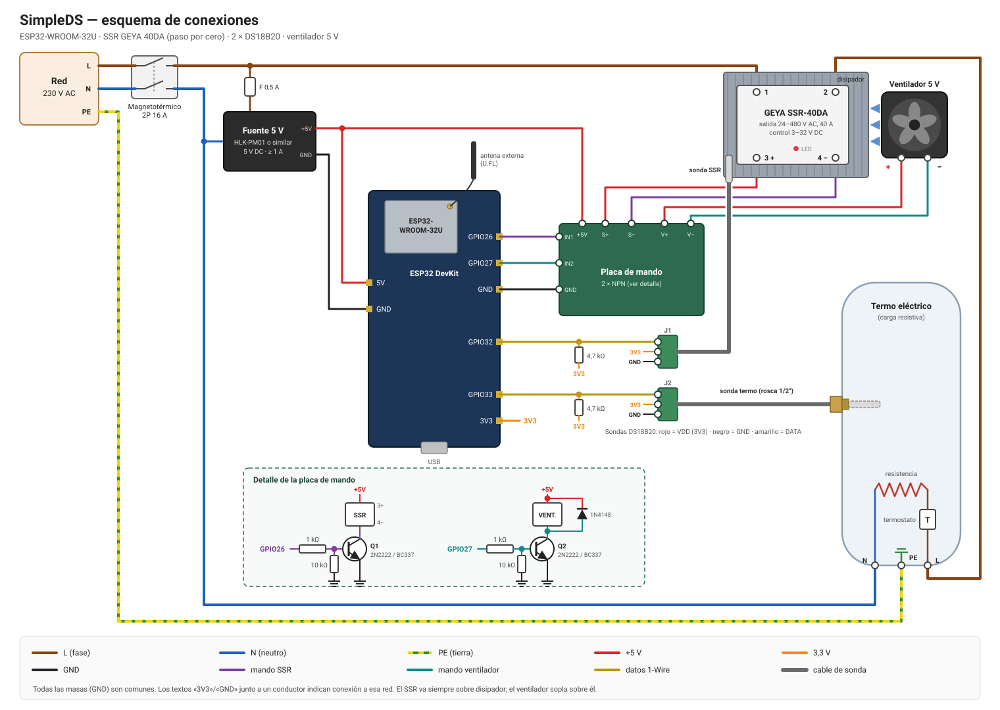

# Arquitectura

Visión de la arquitectura del firmware y registro de sus decisiones. Las
convenciones de código y el stack están en [CLAUDE.md](CLAUDE.md).

## Contexto

```
                    MQTT (broker)
   Controlador ◄──────────────────► ESP32-U ──► Placa de mando ──► SSR ──► Termo (resistencia)
   externo        órdenes de           ▲  │                         ▲
   (decide        potencia (%)         │  └──► Ventilador 5 V ──────┘ (refrigera el SSR)
    cuándo         telemetría          │
    derivar)                           ├── DS18B20 en el disipador del SSR
                                       └── DS18B20 en el termo
```

SimpleDS es un derivador **sin lógica de decisión**: no mide la red ni se
comunica con el inversor. Un controlador externo (Home Assistant, Node-RED, un
script…) le envía por MQTT el porcentaje de potencia que debe recibir la carga
y SimpleDS lo aplica con un SSR de paso por cero, protegiendo el SSR del
sobrecalentamiento y publicando su estado y las temperaturas. Las reglas de
funcionamiento están en [BUSINESS.md](BUSINESS.md).

## Capas

```
┌───────────────────────────────────────────────┐
│ main.cpp            setup()/loop() → App      │
├───────────────────────────────────────────────┤
│ src/app/            composición y ciclo de vida│
├──────────────────────┬────────────────────────┤
│ src/services/        │ src/drivers/           │
│ derivación, WiFi,    │ SSR, ventilador,       │
│ MQTT, web, NVS       │ sondas DS18B20         │
├──────────────────────┴────────────────────────┤
│ lib/core/           dominio portable          │
│ modulación, protección térmica, órdenes,      │
│ ajustes, interfaces (ILoadOutput)             │
└───────────────────────────────────────────────┘
```

**Regla de dependencias:** las flechas apuntan hacia abajo. `lib/core` no
conoce a nadie: no incluye `Arduino.h`, ni ESP-IDF, ni nada de `src/`. Los
drivers y servicios implementan las interfaces definidas en `core`; `app` es el
único lugar donde se instancian y conectan las piezas concretas.

| Directorio       | Responsabilidad                                                | Depende de        |
| ---------------- | -------------------------------------------------------------- | ----------------- |
| `lib/core/`      | Lógica de control, modelos de datos, interfaces de hardware    | Nada (C++ estándar) |
| `src/drivers/`   | Hardware: salidas (`output/`), sondas (`sensors/`), entradas (`input/`) | `core`, Arduino, OneWire |
| `src/services/`  | Lazo de derivación, conectividad, persistencia, interfaz de usuario, telemetría; un subdirectorio por área (`diverter/`, `mqtt/`, `panel/`, `wifi/`, `provisioning/`, `storage/`, `system/`, `web/`) | `core`, Arduino   |
| `src/config/`    | Pines, valores por defecto, versión                            | —                 |
| `src/generated/` | Código generado al compilar (no versionado)                    | —                 |
| `web/`           | Interfaz web (HTML, CSS, JS), un subdirectorio por aplicación (`portal/`, `panel/`) más `common/` | —   |
| `docs/`          | Diagramas (esquema de conexiones)                              | —                 |
| `scripts/`       | Scripts de compilación de PlatformIO                           | —                 |
| `src/app/`       | Composition root: construye, inyecta y orquesta                | todo lo anterior  |
| `test/`          | Tests unitarios de `core` con dobles de las interfaces         | `core`, Unity     |

## Abstracciones principales

- **`ILoadOutput`** (`core/output`): aplica un nivel de potencia normalizado
  `0.0 … 1.0` a la carga. Oculta cómo se modula (hoy, ráfagas de ciclos
  completos con un SSR de paso por cero).
- **`CycleModulator`** (`core/control`): reparte un nivel entre ciclos de red
  completos con un sigma-delta de primer orden (Bresenham): cada ciclo decide
  si conduce, de modo que la proporción de ciclos activos sigue al nivel y
  quedan lo más repartidos posible (50 % = encendido, apagado, encendido…).
- **`CommandTracker`** (`core/control`): guarda la última orden y la caduca si
  no se renueva a tiempo.
- **`ThermalGuard`** (`core/safety`): estado `starting → active ⇄ emergency`
  a partir de las lecturas de la sonda del SSR, con histéresis.
- **`HysteresisSwitch`** (`core/safety`): interruptor de dos umbrales; lo usan
  la protección térmica y el ventilador.
- **Ajustes** (`core/settings`): modelos y validación de `ControlSettings` y
  `MqttSettings`; los errores son `{field, code}` estables para la API.

Ninguna depende del reloj del sistema: el tiempo se pasa como parámetro.

## Flujo del lazo de control

```
MQTT (tarea esp-mqtt) ──► orden % ──► CommandTracker ──┐
                                                       ├─► nivel ──► SsrOutput ──► esp_timer (1 tic por ciclo)
sonda SSR (cada 2 s) ──► ThermalGuard ── ¿permite? ────┘                └─► CycleModulator ──► GPIO ──► SSR
        └──────────────► HysteresisSwitch ──► ventilador (o encendido forzado en emergencia)
sonda termo (cada N s) ──► telemetría MQTT
```

`services/diverter/Diverter::update()` calcula en cada pasada del bucle:
`salida = (ThermalGuard permite y hay orden vigente) ? orden : 0`, y la
entrega a `ILoadOutput`. Cualquier duda (sin orden, orden caducada o inválida,
MQTT desconectado, sonda del SSR averiada, sobrecalentamiento) deja la carga
apagada.

## Modelo de concurrencia

- `loop()` actúa como **planificador cooperativo**: `App::update()` llama al
  `update()` de cada módulo, que hace un trabajo corto y vuelve. Cada módulo
  gestiona su propia temporización con `millis()`.
- Lo que requiera precisión temporal va en **temporizadores hardware**,
  comunicándose con el resto mediante variables atómicas.
- Se crean **tareas FreeRTOS** solo si un módulo no puede ser no bloqueante.
  Casos actuales:

| Contexto | Quién lo crea | Qué hace | Comunicación con `loop()` |
| -------- | ------------- | -------- | ------------------------- |
| Tarea `esp_timer` | ESP-IDF (`SsrOutput`) | Un tic por ciclo de red (20 ms a 50 Hz): decide si el SSR conduce | `std::atomic` con el nivel y la hora del último refresco |
| Tarea de esp-mqtt | ESP-IDF (`MqttConnection`) | Conexión, reconexión, envío y recepción MQTT | `std::atomic` con el estado de conexión y la última orden; las publicaciones se encolan con `esp_mqtt_client_enqueue` |

- **Arrendamiento de la salida:** `SsrOutput` apaga la carga si `loop()` deja
  de refrescar el nivel durante 2 s, de modo que un bloqueo del bucle no deja
  el termo encendido.
- **Sondas:** `Ds18b20Probe` no bloquea: pide la conversión y lee el resultado
  750 ms después en otra pasada del bucle.

## Conectividad WiFi

Al arrancar, `WifiManager` decide el modo según haya o no una red guardada:

```
            ┌─ hay red guardada ──► Estación: conecta y reintenta cada 15 s;
            │                       panel web en http://simpleds.local y en la IP
arranque ───┤
            └─ no hay red ────────► Aprovisionamiento:
                                     1. escaneo de redes (antes de levantar el AP)
                                     2. AP abierto "SimpleDS-XXXX" (XXXX = fin de la MAC)
                                     3. portal cautivo en http://192.168.4.1
                                     4. el usuario elige red y contraseña
                                     5. conexión de prueba con el AP aún activo
                                        ├─ falla ──► error en el portal; no se guarda nada
                                        └─ conecta ► se persiste en NVS y se reinicia
```

| Módulo                                  | Responsabilidad                                         |
| --------------------------------------- | ------------------------------------------------------- |
| `services/wifi/wifi_manager`            | Elige modo al arrancar; olvidar la red                  |
| `services/wifi/wifi_station`            | Conexión a la red configurada y reintentos              |
| `services/wifi/mdns_responder`          | Anuncio `simpleds.local` y servicio `_http._tcp`        |
| `services/panel/control_panel`          | Servidor web del panel en modo estación                 |
| `services/panel/device_status`          | Lectura y JSON del estado del dispositivo               |
| `services/provisioning/captive_portal`  | DNS comodín, rutas web y API del portal                 |
| `services/provisioning/connection_tester` | Conexión de prueba con las credenciales introducidas  |
| `services/provisioning/portal_json`     | Respuestas JSON de la API del portal                    |
| `services/provisioning/access_point`    | Punto de acceso abierto                                 |
| `services/provisioning/network_scanner` | Escaneo asíncrono de redes cercanas                     |
| `services/web/web_assets`               | Tabla de archivos web incrustados                       |
| `services/web/web_responses`            | Envío de archivos web y respuestas JSON                 |
| `services/storage/wifi_credentials_store` | Persistencia de credenciales en NVS                   |
| `services/system/restart_scheduler`     | Reinicio diferido (deja terminar la respuesta HTTP)     |
| `drivers/input/reset_button`            | Pulsación larga del botón BOOT                          |
| `core/network/wifi_credentials`         | Modelo y validación de credenciales (portable)          |
| `core/network/scanned_network`          | Ordenación, deduplicado y nivel de señal de redes (portable) |
| `core/network/connection_failure`       | Clasificación del motivo de fallo de conexión (portable) |
| `core/text/json_escape`                 | Escapado de cadenas JSON (portable)                     |

- **Portal cautivo:** el DNS responde a cualquier dominio con la IP del
  dispositivo y toda ruta desconocida redirige al formulario, de modo que los
  móviles lo abren solos al conectarse.
- **Cambiar de red:** mantener pulsado el botón BOOT 5 s borra la red guardada
  (y la contraseña del panel) y reinicia en modo aprovisionamiento. Es la
  única vía si la contraseña guardada deja de ser válida.
- **Prueba antes de guardar:** las credenciales solo se guardan si la conexión
  de prueba funciona (hasta 2 intentos, 30 s como máximo). Al conectar, el AP
  pasa al canal del router y el móvil puede perder la conexión unos segundos;
  la interfaz reintenta la consulta del resultado, y el reinicio se retrasa
  10 s para que pueda leerlo.
- **API del portal:**

  | Ruta                   | Método | Respuesta |
  | ---------------------- | ------ | --------- |
  | `/api/networks`        | GET    | `{scanning, networks: [{ssid, bars, secured}]}` |
  | `/api/wifi`            | POST   | `ssid`, `password` → `202` (prueba iniciada), `400 {error}` (formato), `409 {error: "busy"}` |
  | `/api/wifi/status`     | GET    | `{status: idle\|testing\|connected\|failed, error?}` |

- **Pantalla final del portal:** muestra `http://simpleds.local` y la IP obtenida
  en la prueba, porque `.local` no funciona en todos los Android.
- **mDNS e IPv6:** al conectar se crea una dirección IPv6 de enlace local para
  que mDNS responda también a las consultas AAAA; sin ella macOS tarda ~5 s en
  resolver `simpleds.local`.
- **Escaneo:** con el AP activo la radio alterna canales y un escaneo tarda
  ~12 s, así que el primero se hace de forma síncrona antes de levantar el AP
  y los siguientes son asíncronos.

## Derivación

| Módulo | Responsabilidad |
| ------ | --------------- |
| `services/diverter/diverter` | Lazo de control: sondas, protección térmica, ventilador, orden y salida |
| `services/mqtt/mqtt_connection` | Cliente esp-mqtt: conexión, última voluntad, suscripción y cola de envío |
| `services/mqtt/mqtt_bridge` | Lleva las órdenes al `Diverter` y publica estado, potencia, ventilador y temperaturas |
| `services/storage/control_settings_store` | Ajustes de protección y tiempos en NVS (`control`) |
| `services/storage/mqtt_settings_store` | Ajustes MQTT en NVS (`mqtt`) |
| `drivers/output/ssr_output` | `ILoadOutput` sobre el SSR: `esp_timer` + `CycleModulator` |
| `drivers/output/fan_output` | Ventilador encendido/apagado |
| `drivers/sensors/ds18b20_probe` | Una DS18B20 por bus 1-Wire, lectura no bloqueante |
| `core/control/*`, `core/safety/*`, `core/settings/*`, `core/sensors/*` | Lógica portable (ver *Abstracciones principales*) |

- **Modulación por ciclos completos:** el SSR es de paso por cero, así que no
  admite control por ángulo de fase. Cada tic del temporizador dura un ciclo de
  red (20 ms): si la entrada del SSR está activa durante el tic, el SSR conduce
  exactamente dos semiciclos (entra en el primer cruce por cero y sale en el
  primero tras desactivarse). Usar ciclos completos evita componente continua.
  La resolución es del 0,1 % y la potencia media se alcanza en pocos ciclos.
- **Sin detección de cruce por cero en el ESP32:** el temporizador no está
  sincronizado con la red. La deriva entre ambos relojes puede alargar o
  acortar ocasionalmente una ráfaga en un semiciclo, sin efecto práctico en
  una carga resistiva.
- **Ajustes en caliente:** los umbrales, el intervalo de telemetría y la
  caducidad de la orden se aplican al guardarlos. Los de MQTT requieren
  reinicio (el cliente se configura una sola vez al arrancar).
- **MQTT:** arranca con la primera IP; si no hay servidor configurado queda
  desactivado y la carga permanece apagada. El contrato de topics y mensajes
  está en [BUSINESS.md](BUSINESS.md).

## Interfaz web

Dos aplicaciones web, nunca activas a la vez:

| Aplicación | Modo | Directorio | API |
| ---------- | ---- | ---------- | --- |
| Portal de aprovisionamiento | AP | `web/portal/` | ver *Conectividad WiFi* |
| Panel de control | Estación | `web/panel/` | ver tabla siguiente |

- Los archivos de `web/` se comprimen con gzip y se incrustan en el firmware al
  compilar (`scripts/embed_web_assets.py` → `src/generated/`). Se sirven con
  `Content-Encoding: gzip` en la misma ruta que tienen en `web/`.
- Las páginas son estáticas: los datos llegan por una API JSON. El firmware
  devuelve códigos (`wrong_password`, `ssid_empty`…) y los textos para el
  usuario viven en el JavaScript.
- Sin herramientas de frontend (npm, bundlers): HTML, CSS y JS sin compilar.

API del panel (todas las rutas `/api/*` salvo login y logout exigen sesión si
hay contraseña; si no, responden `401 {error: "unauthorized"}`):

| Ruta | Método | Petición / respuesta |
| ---- | ------ | -------------------- |
| `/api/status` | GET | `{device: {firmware, hostname, ssid, ip, rssi, bars, uptime, freeHeap}, diverter: {state, reason, output, command, ssrTemperature, ssrSampled, tankTemperature, tankSampled, fan}, mqtt: disabled\|connecting\|connected}` |
| `/api/settings` | GET | `{control: {…}, mqtt: {…, hasPassword}, panel: {hasPassword}}` (nunca devuelve contraseñas) |
| `/api/settings/control` | POST | `ssrTripC, ssrResetC, fanOnC, fanOffC, telemetryIntervalS, commandTimeoutS` → `200` / `400 {error: "invalid", field, code}` |
| `/api/settings/mqtt` | POST | `host, port, username, password, clientId, *Topic` → `200 {restarting: true}` y reinicio / `400` |
| `/api/settings/password` | POST | `password` (vacía = quitar) → `200 {hasPassword}` / `400` |
| `/api/login` | POST | `password` → `204` + cookie / `401 {error: "wrong_password"}` / `429 {error: "locked"}` |
| `/api/logout` | POST | `204`, borra la cookie |

- **Contraseña del panel:** opcional. Con ella, `GET /` redirige a
  `/panel/login.html` sin sesión. La sesión es una cookie `sid` aleatoria de
  128 bits (`HttpOnly`, `SameSite=Strict`) guardada en RAM: hasta 4 sesiones,
  se pierden al reiniciar o cambiar la contraseña. Tras 5 intentos fallidos el
  login se bloquea 1 minuto. Los archivos estáticos son públicos (no contienen
  datos).
- **Recuperación:** la pulsación larga del botón BOOT borra también la
  contraseña del panel.

## Montaje del hardware



### Componentes

| Componente | Modelo | Función |
| ---------- | ------ | ------- |
| Microcontrolador | Placa de desarrollo con ESP32-WROOM-32U + antena 2,4 GHz (U.FL) | Firmware |
| Relé de estado sólido | GEYA SSR-40DA: paso por cero, control 3–32 V DC, salida 24–480 V AC, 40 A | Conmuta la resistencia del termo |
| Disipador | Aluminio, dimensionado para la carga (ver notas) | Evacua el calor del SSR |
| Sonda del SSR | DS18B20 en tubo de acero inoxidable 304 de 6 × 30 mm, cable de 1 m | Protección térmica y ventilador |
| Sonda del termo | DS18B20 con rosca de 1/2" | Telemetría de la temperatura del agua |
| Ventilador | 5 V DC (40–60 mm) | Refrigera el disipador |
| Fuente de alimentación | 230 V AC → 5 V DC, ≥ 1 A (HLK-PM01 o similar) con fusible de 0,5 A | Alimenta ESP32, mando del SSR y ventilador |
| Placa de mando | 2 × NPN (2N2222 o BC337), 2 × 1 kΩ, 2 × 10 kΩ, 1 × 1N4148 | Adapta las salidas de 3,3 V |
| Pull-ups 1-Wire | 2 × 4,7 kΩ | Una por bus |
| Protección | Magnetotérmico bipolar 16 A (según la potencia del termo) | Corte y protección de la línea |

### Conexiones

| ESP32 | Destino | Notas |
| ----- | ------- | ----- |
| `5V` (VIN) | +5 V de la fuente | Alimentación de la placa |
| `GND` | GND de la fuente, placa de mando y sondas | Masa común |
| `GPIO26` | Placa de mando IN1 → base de Q1 (1 kΩ) | Mando del SSR, activo a nivel alto |
| `GPIO27` | Placa de mando IN2 → base de Q2 (1 kΩ) | Mando del ventilador, activo a nivel alto |
| `GPIO32` | DATA de la sonda del SSR + 4,7 kΩ a 3V3 | Bus 1-Wire propio |
| `GPIO33` | DATA de la sonda del termo + 4,7 kΩ a 3V3 | Bus 1-Wire propio |
| `3V3` | VDD de ambas sondas y pull-ups | Alimentación de las DS18B20 |

| Elemento | Conexión |
| -------- | -------- |
| SSR `3 +` | +5 V |
| SSR `4 −` | Colector de Q1 (emisor a GND) |
| SSR `1` | Fase (L) tras el magnetotérmico |
| SSR `2` | Fase hacia el termo (a través de su termostato) |
| Ventilador `+` | +5 V (con diodo 1N4148 en antiparalelo, cátodo a +5 V) |
| Ventilador `−` | Colector de Q2 (emisor a GND) |
| Termo | N directo; PE a la carcasa |
| Sondas DS18B20 | Rojo = VDD (3V3), negro = GND, amarillo = DATA (confirmar con el vendedor: algunos cables usan otros colores) |

### Notas de montaje

- **Mando con transistor:** los pines del ESP32 dan 3,3 V y pocos mA. El SSR
  admite 3 V, pero con margen escaso; con un NPN se alimenta a 5 V. El
  ventilador no puede alimentarse desde un GPIO. Las resistencias de 10 kΩ
  mantienen los transistores cortados mientras el ESP32 arranca (pines en
  alta impedancia), así que la carga nunca se enciende durante el arranque.
- **Pines elegidos:** `GPIO26/27` no son pines de arranque ni emiten pulsos
  al iniciar; `GPIO32/33` admiten entrada y salida (1-Wire las necesita). Se
  centralizan en `src/config/pins.h`.
- **Un bus por sonda:** cada DS18B20 va en su propio pin, así el firmware sabe
  cuál es cuál sin configurar direcciones ROM y una sonda averiada no afecta a
  la otra.
- **Disipador del SSR:** el SSR disipa ~1–1,5 W por amperio (unos 10–13 W con
  un termo de 2 kW). Montar con pasta térmica sobre un disipador generoso; el
  valor de 40 A es nominal y requiere disipación adecuada. La sonda de 6 mm se
  fija al disipador junto a la base del SSR (abrazadera o taladro con pasta
  térmica) y el ventilador sopla sobre las aletas.
- **Sonda del termo:** la versión con rosca de 1/2" se enrosca en una toma
  libre del termo o en una T en la salida de agua caliente; si el termo tiene
  vaina para sonda, también puede alojarse en ella.
- **El termostato del termo se mantiene en serie:** es la protección
  independiente contra el sobrecalentamiento del agua; SimpleDS no la sustituye.
- **Secciones y aislamiento:** la parte de 230 V (fase, neutro, tierra y
  salida del SSR) con cable de 2,5 mm² y en caja aislada, separada de la parte
  de baja tensión. La fuente de 5 V debe ser aislada.

## Memoria flash

Tabla de particiones `min_spiffs` (flash de 4 MB):

| Partición  | Tamaño  | Uso |
| ---------- | ------- | --- |
| `nvs`      | 20 KB   | Configuración persistente |
| `app0`/`app1` | 1,9 MB cada una | Firmware, dos ranuras para OTA |
| `spiffs`   | 128 KB  | Sin uso |
| `coredump` | 64 KB   | Volcado tras un fallo |

## Convenciones del dominio

- **Unidades:** temperaturas en °C (`float`); tiempos en milisegundos
  (`uint32_t`) en el código y en segundos en los ajustes de usuario.
- **Potencia:** porcentaje `0 … 100` en MQTT y en la API; valor normalizado
  `0.0 … 1.0` en `ILoadOutput`; la traducción a ráfagas de ciclos es
  responsabilidad del driver.

## Ciclo de vida

```
arranque ──► starting ──► active ◄──► emergency
                          (sobrecalentamiento o sonda del SSR averiada)
```

En `starting` y `emergency` la salida está siempre a 0. `starting` dura hasta
la primera lectura de la sonda del SSR (~1 s).

## Decisiones pendientes

- Actualizaciones OTA (las particiones ya están preparadas).
- MQTT sobre TLS.
- Descubrimiento automático en Home Assistant (MQTT discovery).
- Seguridad del portal (hoy el AP es abierto) y protección CSRF del panel
  cuando no tiene contraseña.
- Nombre mDNS configurable desde el panel (hoy fijo: `simpleds`).
- Detección de cruce por cero en el ESP32 si se necesitara sincronizar las
  ráfagas con la red.

## Registro de decisiones

| Fecha      | Decisión | Motivo |
| ---------- | -------- | ------ |
| 2026-10-05 | Arquitectura en capas con dominio portable en `lib/core` | Testear la lógica sin hardware y aislarla de los detalles físicos. |
| 2026-10-05 | ~~Hardware detrás de interfaces (`IPowerMeter`, `ILoadOutput`)~~ Sustituida: sin medida de red; se mantiene `ILoadOutput` | Poder cambiar de sensor o actuador sin tocar el control. |
| 2026-10-05 | `App` como único composition root | Un solo punto donde se decide qué implementación concreta se usa. |
| 2026-10-05 | `loop()` como planificador cooperativo; ISR para lo crítico en tiempo; FreeRTOS solo si se justifica | Simplicidad y determinismo; evitar condiciones de carrera innecesarias. |
| 2026-10-05 | Supervisor de seguridad independiente del regulador (hoy `ThermalGuard`, independiente de las órdenes) | La seguridad no depende de la corrección del algoritmo de control. |
| 2026-10-05 | ~~Potencia de red con signo: + importación, − exportación~~ Sustituida: el dispositivo no mide la red | Convención única en todo el código. |
| 2026-10-05 | Sin red guardada, aprovisionamiento por AP abierto + portal cautivo; con red guardada, solo modo estación con reintentos | Configuración sin app ni cable; el AP no aparece mientras haya una red configurada. |
| 2026-10-05 | Credenciales en un namespace NVS propio (`wifi`) y `WiFi.persistent(false)` | Una única fuente de verdad, independiente de la copia interna del core. |
| 2026-10-05 | Pulsación larga (5 s) del botón BOOT para olvidar la red y la contraseña del panel | Vía de recuperación si la red o la contraseña cambian; quien tiene acceso físico puede recuperar el panel. |
| 2026-10-05 | Reinicio tras guardar la configuración | Arranque limpio en modo estación en lugar de transiciones de modo en caliente. |
| 2026-10-05 | Particiones `min_spiffs`: 2 × 1,9 MB para la aplicación | La pila WiFi ocupa ~550 KB fijos; deja margen manteniendo OTA. El sistema de archivos no se usa. |
| 2026-10-05 | Interfaz web en `web/`, incrustada comprimida en el firmware en lugar de en un sistema de archivos | Fuentes ordenadas sin coste en flash; un único binario, sin desajustes entre firmware y archivos en OTA, y el portal siempre disponible. |
| 2026-10-05 | Páginas estáticas + API JSON; textos de usuario solo en el frontend | Permite servir los archivos comprimidos sin plantillas y separa datos de presentación. |
| 2026-10-05 | Las credenciales se prueban antes de guardarlas | Evita dejar el dispositivo con una contraseña errónea y sin portal. |
| 2026-10-05 | Acceso al panel por mDNS (`simpleds.local`) y por IP | `.local` es memorable pero no universal (Android); la IP es la alternativa. |
| 2026-10-05 | Panel de control y portal como servicios separados, cada uno con su servidor web, según el modo | Responsabilidades y rutas independientes; solo uno está activo. |
| 2026-10-05 | El dispositivo no decide cuándo derivar: ejecuta órdenes de potencia (%) de un controlador externo por MQTT | Mantenerlo simple e independiente del inversor; la decisión vive en el sistema domótico. |
| 2026-10-05 | Modulación por ciclos completos con sigma-delta (Bresenham) sobre un SSR de paso por cero | El SSR no permite ángulo de fase; ciclos completos sin componente continua y lo más repartidos posible. |
| 2026-10-05 | `esp_timer` en modo tarea para el tic de ciclo, sin detección de cruce por cero | Temporización estable sin depender del bucle ni de restricciones de ISR; el SSR ya conmuta en el cruce. |
| 2026-10-05 | Arrendamiento de 2 s del nivel del SSR | Un bucle bloqueado no puede dejar la carga encendida. |
| 2026-10-05 | Cliente MQTT de ESP-IDF (esp-mqtt) con publicaciones encoladas | Incluido en el framework, no bloquea el bucle y reconecta solo. |
| 2026-10-05 | Una DS18B20 por bus 1-Wire (`GPIO32`, `GPIO33`) | Identificación sin configurar direcciones ROM y fallos aislados. |
| 2026-10-05 | Etapa de mando con NPN a 5 V para SSR y ventilador, con pull-down en base | Margen de tensión para el SSR, corriente para el ventilador y salida apagada durante el arranque. |
| 2026-10-05 | Contraseña del panel opcional con sesión por cookie en RAM y bloqueo tras 5 fallos | Interfaz propia en español y cierre de sesión, sin dependencias; sesiones que caducan al reiniciar. |
| 2026-10-05 | Ajustes MQTT aplicados con reinicio; el resto, en caliente | El cliente MQTT reserva memoria al crearse; reiniciar evita recrearlo y sigue la decisión de reiniciar tras configurar. |
| 2026-10-05 | Esquema de conexiones como SVG en `docs/` | Se ve en GitHub y en cualquier navegador y se versiona como texto. |
